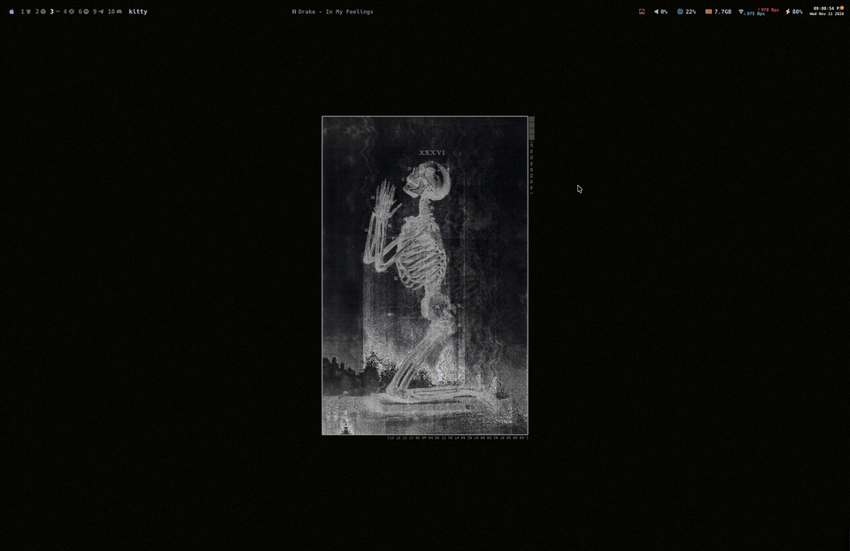

<p align="center">
  <picture>
    <source media="(prefers-color-scheme: light)" srcset="crates/ui/src-tauri/icons/source/icon-day.png" />
    
  </picture>
</p>
<h2 align="center">kakemono</h2>
<p align="center">
  <a href="https://github.com/RielJ/kakemono/releases/latest"></a>
  <a href="https://github.com/RielJ/kakemono/actions/workflows/ci.yml"></a>
  
  <a href="LICENSE"></a>
</p>
<p align="center">
  <strong>A free wallpaper manager for macOS, Linux, and Windows.</strong><br>
  New wallpapers from Wallhaven, Unsplash, Reddit, Bing, NASA APOD, any web page, or your own folders.
</p>
<p align="center">
  <a href="https://kakemono.rielj.xyz"><strong>Documentation</strong></a> ·
  <a href="https://kakemono.rielj.xyz/install/">Install</a> ·
  <a href="https://kakemono.rielj.xyz/reference/configuration/">Configuration</a> ·
  <a href="CONTRIBUTING.md">Contributing</a>
</p>



---

kakemono changes your wallpaper when you ask, or on a timer. It keeps a history you can step back through, saves favorites, and can pick dark images in dark mode and light images in light mode.

| | |
|---|---|
| **Sources** | Wallhaven, Unsplash, Reddit, Bing, NASA APOD, web pages and feeds, and your own folders. Paste a Wallhaven or Reddit search URL and kakemono uses its filters. |
| **Picker** | A strip of previews from the menu bar or a shortcut. Click one to set it. |
| **History** | Step back and forward through past wallpapers, favorite the good ones, trash the bad ones. |
| **Scriptable** | One binary is the daemon and the command-line tool. Hooks run on every change, and a local socket speaks JSON. |

## Install

```sh
# macOS: the app, with the kakemono command
brew install --cask rielj/tap/kakemono

# Arch Linux, from the AUR
yay -S kakemono-bin
```

```powershell
# Windows, with Scoop
scoop install https://raw.githubusercontent.com/RielJ/scoop-bucket/main/bucket/kakemono.json
```

For the `.dmg`, the Windows installer, `.deb`, `.rpm`, AppImage, and the command-line tool on its own, see the [install guide](https://kakemono.rielj.xyz/install/). Every file is also on the [Releases](https://github.com/RielJ/kakemono/releases) page. The builds are not signed yet, so each system warns you the first time. The guide shows what to click.

## Quick start

Open the kakemono app. A Welcome window walks you through a first setup. Or use the command line:

```sh
kakemono daemon          # start the daemon in the background
kakemono next            # set a new wallpaper now
kakemono prev            # go back in the history
kakemono favorite        # keep the current wallpaper
kakemono pause           # stop the timer; `kakemono resume` starts it again
```

On Linux, if wallpapers don't change, run `kakemono doctor`.

## Documentation

Everything else is on [kakemono.rielj.xyz](https://kakemono.rielj.xyz):

- [How to use kakemono](https://kakemono.rielj.xyz/using/) and [where pictures come from](https://kakemono.rielj.xyz/sources/)
- [The picker](https://kakemono.rielj.xyz/guides/picker/) and [timer, history, and filters](https://kakemono.rielj.xyz/guides/changing-wallpapers/)
- [Linux desktops](https://kakemono.rielj.xyz/guides/linux/) and [status bars and hooks](https://kakemono.rielj.xyz/guides/bars-and-hooks/)
- [Commands](https://kakemono.rielj.xyz/reference/commands/), [configuration file](https://kakemono.rielj.xyz/reference/configuration/), [files and folders](https://kakemono.rielj.xyz/reference/files/), and [socket protocol](https://kakemono.rielj.xyz/reference/socket/)
- [Troubleshooting](https://kakemono.rielj.xyz/troubleshooting/)

To build kakemono, run the tests, or make a release, see [CONTRIBUTING.md](CONTRIBUTING.md).

## License

MIT. See [LICENSE](LICENSE).
